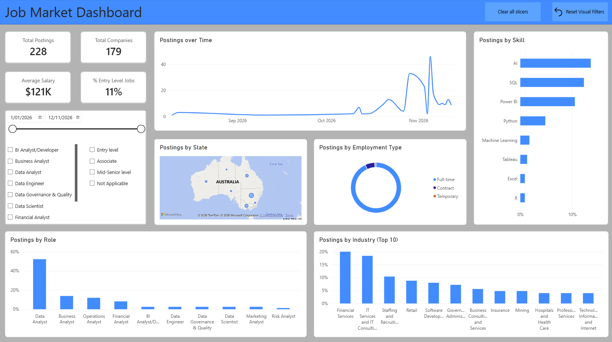

# What is this project?

This project provides information on the job market for roles in the data or analytics professions, displayed in a Power BI report. It helps job seekers in this field to better understand the job market, by answering questions such as how big the market is, where the jobs are located, and what skills are in demand. It uses a fully automated ETL pipeline to collect, transform, and load data. The image below is the dashboard containing the results. 

# Future Improvements

- Include more job sites
- Add a data dictionary to the docs
- Include a live dashboard link in the README file instead of a statis image
- Add more skills and also include a skill hierarchy

For further information about the project, please refer to the docs. 